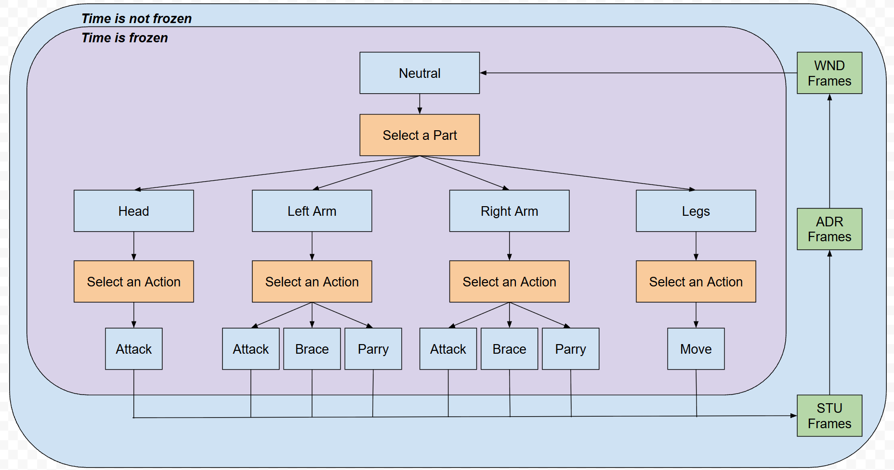
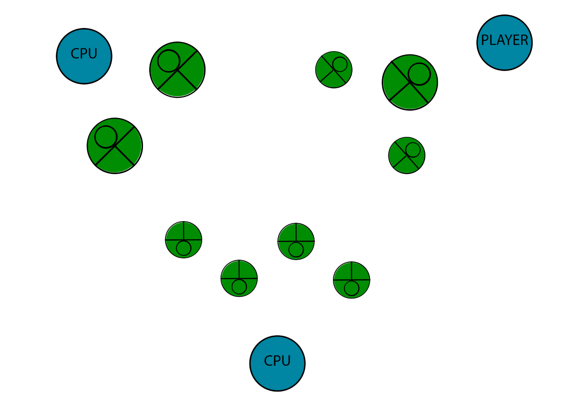

# Combat flow

Source: prototype specifications, the combat process, win conditions, and CPU notes.

## Prototype bar

- Playable with a controller.
- Runs at 60 FPS.

## Command loop

Play is real-time. Time freezes whenever a Ringbot the player controls enters Neutral. The player can take as long as they want to pick the next action. If more than one of their Ringbots is in Neutral, the player chooses which one to order first.

For a single Ringbot:

1. It is in Neutral. Time is frozen. The player selects an action.
2. Time resumes. The Ringbot performs the action. The phases are start-up, active time, then wind-down (`STU`, then `ADR`, then `WND`), unless the action is interrupted.
3. When the action finishes, the Ringbot returns to Neutral.

That cycle runs for every Ringbot in the fight. The timing values are in [resolution.md](resolution.md).

The source flow figure is more specific about what the player picks while time is frozen. From Neutral they select a part, then an action on that part:

- Head: Attack.
- Left arm: Attack, Brace, or Parry.
- Right arm: Attack, Brace, or Parry.
- Legs: Move.

Time stays frozen through that choice. Start-up, active time, and wind-down (`STU`, `ADR`, `WND`) run while time is moving, and wind-down returns the Ringbot to Neutral. The eight action categories in [actions.md](actions.md) are the attack and support vocabulary; this figure is the part-selection path around them.

Two extra constraints:

- Line of sight between the Rightfighter and their Ringbot is required to issue a command. The source prints Rightfighter.
- A Ranged projectile hits allies if they are on its path. Drone and Missile are the techniques that ignore allies.

## Win conditions

Setting 1 is the prototype target. Victory is defeating every remaining Ringbot that is not an ally.

The match also ends, under the organized-play rules, when one Ringfighter has no functioning Ringbot left. They lose. Defeat of a Ringbot is damage to its unarmoured head. In a staked match the loser gives up one fielded Head, right arm, left arm, or leg set. Part rules are in [components.md](components.md).

## Deferred: Setting 2

The source says to save this win condition. Victory there is either defeating every remaining non-allied Ringbot, or disabling every remaining non-allied Ringfighter. Disabling the Ringfighter disables all of their Ringbots at once, so Ringbots also have to bodyguard their owner. A third Ringfighter can join a fight already in progress.

## CPU

Opponent behavior is a weighted decision tree. The source schedules it as one of the last prototype tasks. No weights or branches are written, and the combat ideas list after it is still empty.
