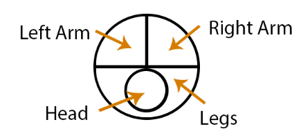
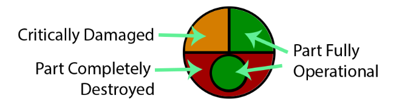
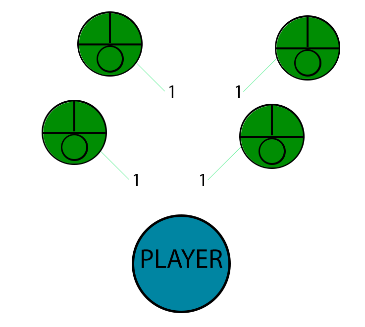
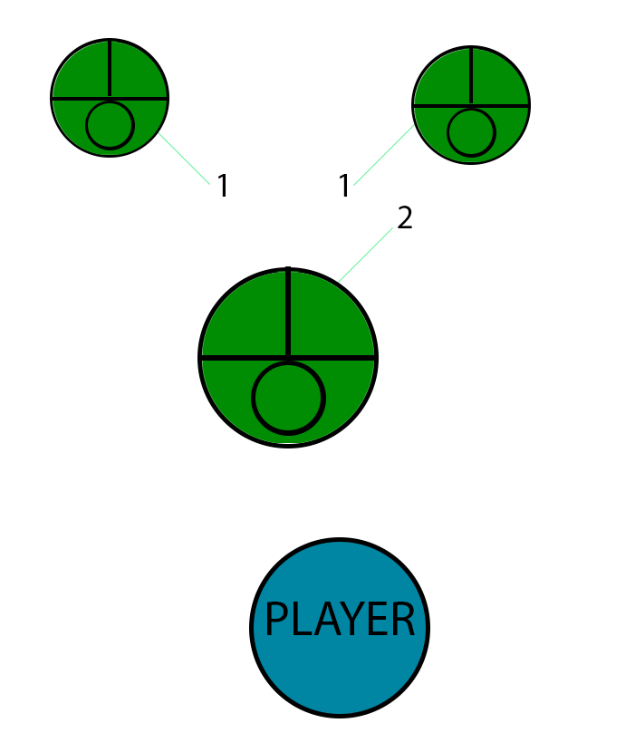
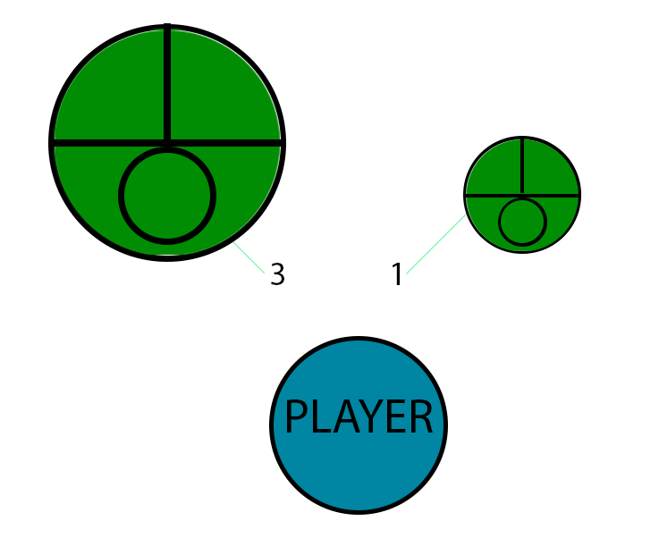
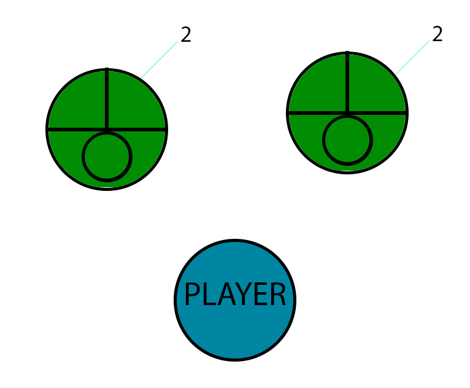
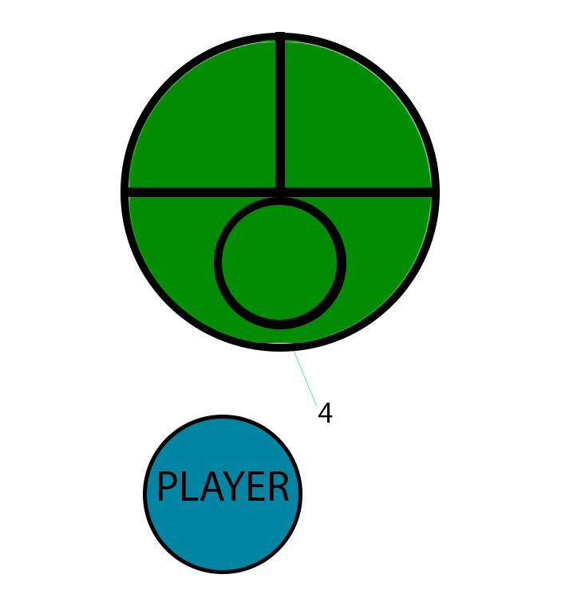
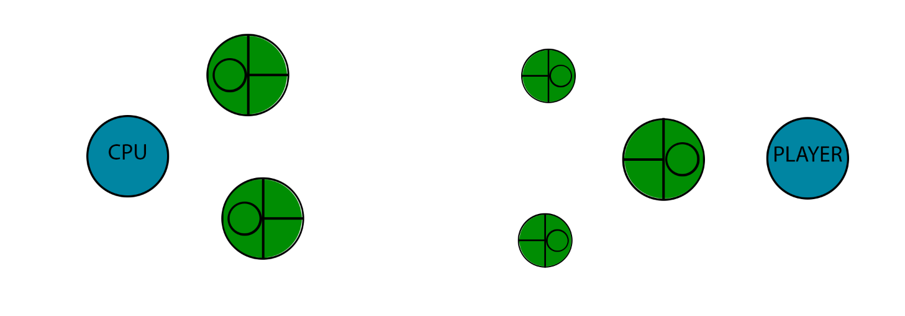

# Components and teams

Source: Ringbot overview, plus the Setting 1 organized-play rules. Flavor about the world is left in the design document.

## Parts

A Ringbot is six components. Every component is universal and can be swapped onto any Ringbot.

| Component | Role |
| --- | --- |
| Head | Protects the head and torso. The Ringbot is defeated when its unarmoured head takes unmitigated damage, whatever state the other parts are in. |
| Arms (left and right) | Protect the arms and shoulders. Each arm is its own component. |
| Leg set | Protects the waist and lower body. Governs movement. |
| Frame | The skeleton the other parts fasten to. Default shape is bipedal; limbs take the shape of the part equipped on them. Built to keep working with rare maintenance. |
| Pair-ring | The processor and the remote control, issued as a matched pair. |

The control pair is two rings. One has the controller interface and is worn on the non-dominant hand, interface toward the palm. The other sits in the Frame, between the vertebrae of the upper back. The Ringfighter drives that Ringbot by bringing both hands together and using the dominant hand on the controls.

Up to four control rings can be worn at once, on the index, middle, ring, and pinky fingers. The matching finger on the dominant hand works that ring. The thumbs are shared across rings during combat.

Head and Arm parts each have a Technique, which adds an effect on top of the action category. See [techniques.md](techniques.md). Which stats each part carries is in [stats.md](stats.md). The named parts and the numbers on the sheet are in [catalog/parts.csv](catalog/parts.csv). Ring names and their action numbers are in [catalog/rings.csv](catalog/rings.csv).

## Prototype body

The prototype is top-down. The four parts that have Armour are drawn: Head, left arm, right arm, and leg set. Frame and Pair-ring have no Armour stat.

Part color shows that part's current Armour. A part works at full function until it is destroyed. Destroyed means Armour has reached 0. Further damage to a destroyed part does nothing, except on the Head, where damage to the unarmoured head defeats the Ringbot.

## Teams

A Ringfighter wears up to four Pair-rings and can field from one to four Ringbots, depending on how those rings are allocated. The player starts with one set and works up to four.

RAM Slots on the Frame are the number of Pair-rings allocated to that Ringbot, and they change the Ringbot's size. The source figures show every way to split four rings. The number on each link is that Ringbot's ring count, and the drawn body grows with it.

Four Ringbots, one ring each:

Three Ringbots, split 2 / 1 / 1. The Ringbot with 2 is larger:

Two Ringbots, split 3 / 1:

Two Ringbots, split 2 / 2:

One Ringbot with all four rings:

## Deployment

At the start of combat the teams are summoned facing each other. Each Ringfighter chooses where their Ringbots deploy, inside a distance from their owner. That distance is not given a number.

## Setting 1 match rules

Organized play uses these rules:

- Every Ringbot in the match uses officially supported components.
- Combat ends when every Ringbot on one side is defeated. The first Ringfighter with no functioning Ringbot loses.
- In a staked match, the loser forfeits one component they actually fielded, chosen from Head, right arm, left arm, or leg set. Frame and Pair-ring are not on that list.

Jerry-rigged parts from the future setting are not legal in this ruleset. Other Ringfighters refuse the match. Some will still accept, trying to win a part as forfeit.

Setting 2 changes the win condition and is deferred in [combat-flow.md](combat-flow.md).
