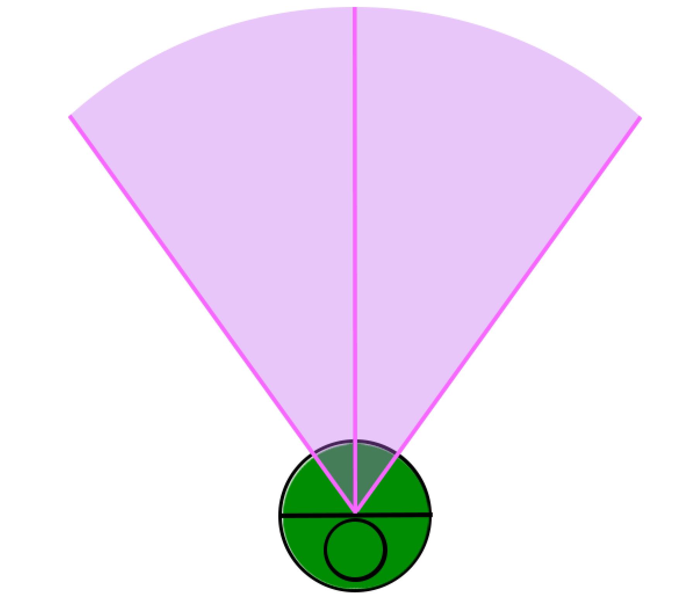
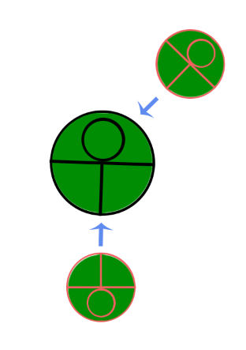
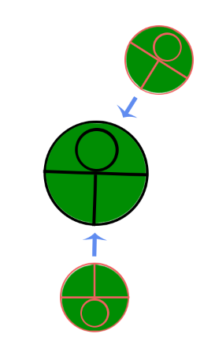
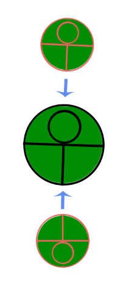

# Combat resolution

Source: the combat function list, field of view, cross-crush, leg types, and the mechanical glossary. Inputs are what the source names. None of these are written as formulas, and no constants are given.

"User" is the Ringbot the value is about, unless an input says Source or Target. Those labels are kept as printed, including where the same idea is worded differently on neighboring rows.

## Timing

Combat time is real, except when a player Ringbot is waiting for an order. The command loop is in [combat-flow.md](combat-flow.md).

| Output | Abbr. | Type | Meaning | Inputs |
| --- | --- | --- | --- | --- |
| Boot Time | BTT | Continuous | Time to reach Neutral at the start of combat. | User's RAM, user's Propulsion. |
| Action Start-up | STU | Discrete | Time to perform an action, measured from Neutral. | User's RAM, user's Charge. |
| Action Duration | ADR | Discrete | How long the action is active. | User's Active. |
| Action Wind-down | WND | Discrete | Time to return to Neutral after the action. | User's RAM, user's Radiation. |

The worked example in the source runs an action as start-up, then active time, then wind-down (`STU`, then `ADR`, then `WND`), unless something interrupts it.

| Output | Abbr. | Type | Meaning | Inputs |
| --- | --- | --- | --- | --- |
| Hitstun | HST | Discrete | How long a hit keeps the target from returning to Neutral. | User's Charge, user's Radiation. |
| Hitstop | HTS | Discrete | How long combat freezes to sell the impact. | User's Damage. |

## Damage

| Output | Abbr. | Type | Meaning | Inputs |
| --- | --- | --- | --- | --- |
| Damage | DMG | Discrete | Damage dealt to parts that were hit. | User's Power, user's Affinity, user's Proximity or Remoteness, user's RAM, user's Intent, target's Defence. |
| Intent | INT | Continuous | Percent scalar on damage. | User's Rate of Success, user's RAM, user's Affinity, user's Proximity or Remoteness, user's Centering, target's Evasion. |
| Dampening | DMP | Binary | True when the incoming action's Intent is under 100%. | Source's Intent. |
| Critical Hit | CRT | Binary | True when the action's Intent is 200% or more. | User's Intent. |
| Cross-Crush | CRC | Continuous | Extra damage scalar from the target's pushback trajectory. | Target's Pushback Distance, target's Pushback Rate. |

Proximity is the Grapple input. Remoteness is the Ranged input.

When Dampening is true, the incoming damage is redirected to whichever non-Head part has the most Armour left.

On a Critical Hit, excess incoming damage overflows into other parts, prioritizing non-Head parts with the most Armour left.

Drone sets the action's Intent to 200%. Missile sets it to 100%. Both are techniques, and both make the projectile ignore allies on its path.

## Space and facing

Each Ringbot has a field of view. The centerline points straight ahead. The radius is Reach for a Grapple action and Range for a Ranged action. The width of the periphery comes from the action's Scope.

| Output | Abbr. | Type | Meaning | Inputs |
| --- | --- | --- | --- | --- |
| Scope | SCP | Continuous | How far off the facing direction a target can still be selected. | User's Attribute. |
| Centering | CTR | Continuous | Angle from the target to the centerline of the action's Scope. | User's Scope. |
| Size | SIZ | Continuous | Space the Ringbot occupies. | User's RAM. |

The Scope *value* is this derived tolerance. The Scope *class* on an action (Standard, Wide, Narrow, Unrestricted) is defined in [actions.md](actions.md).

| Output | Abbr. | Type | Meaning | Inputs |
| --- | --- | --- | --- | --- |
| Pushback Distance | PBD | Continuous | How far damage pushes the target backward. | Source's Damage, user's RAM, user's total Armour. |
| Pushback Rate | PBR | Continuous | How fast that push moves the target. | Source's Damage, user's RAM, user's total Armour. |
| Poise | POI | Continuous | Resistance to being interrupted by an opponent's attack. | Source's Damage, user's RAM, user's total Armour. |
| Travel | TRV | Continuous | The rate at which a Ringbot may move in a single action. | User's Type, user's Propulsion, user's RAM. |
| Torque | TRQ | Continuous | The rate at which the Ringbot can rotate along its centerpoint. | User's RAM, user's Proximity or Remoteness. |

Cross-Crush applies when the target is already in pushback and that pushback trajectory points toward the Ringbot that is hitting it. In the source figures the bottom Ringbot hits the middle one and pushes it upward, while a second hit comes from the top Ringbot at a downward angle. Potency increases from the first figure to the third. No angles are given.

## Terrain

Leg Type is the leg set's Type stat. It changes how well movement actions work on a terrain.

| Leg type | Best terrain |
| --- | --- |
| Air | Plains and desert. |
| Multi-legged | Rocky and valley. |
| Two-legged | Grasslands and forest. |
| Wheels | City and interior. |
| Sea | Shore and underwater. |
| Float | Performs well everywhere. |
| Tank | Unaffected by terrain. |

## Terms

| Term | Meaning |
| --- | --- |
| Neutral | The state in which a Ringbot can take orders. |
| Parry | Cancels an incoming Strike, Berserk, Shoot, or Aim Shot. If it triggers, the user returns to Neutral immediately. |
| Clash | Attacks can clash, reducing Radiation by a specified factor for the rest of that action. A Clash occurs when two or more opposing attacks collide within their ADR state. |
| Quirk | Extra effect from the action category. |
| Technique | Extra effect from the specific action. |
| Status condition | See [status-conditions.md](status-conditions.md). One of each at a time; a new application of the same status replaces the old one. |
